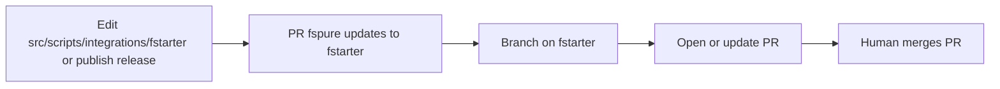

# Sync fspure integration pack → `e-St/fstarter` (pull request)

The **source of truth** for how fstarter enables fspure is:

```text
e-St/fspure  →  src/scripts/integrations/fstarter/
```

Target:

```text
https://github.com/e-St/fstarter
```

Unlike `fspure-ready-lib` (force-push satellite), **fstarter** receives a **pull request** so template maintainers can review pin and setup changes. The title names the actual change (`fspure: pin skill main → fspure-reduce-impurity-v0.1.1`, `fspure: update Codespace setup`, …). The body leads with what Codespaces will do after merge, lists only pins that change, and names only pack files that differ. A run that would only bump `.fspure-sync-source` does **not** open a PR. Skill-only edits on fspure do not open an fstarter PR (the skill is not copied into the template; the pin is).



## What gets updated

| Path in fstarter | Source |
|------------------|--------|
| `.devcontainer/setup-fspure.sh` | `src/scripts/integrations/fstarter/overlay/.devcontainer/setup-fspure.sh` |
| `.devcontainer/bake-fspure.sh` | overlay (image bake: poll nuget.org, then GitHub Release nupkg) |
| `.devcontainer/devcontainer.json` | overlay (fspure Ionide / decorations settings) |
| `.devcontainer/fspure-versions.env` | generated pins (`FSPURE_ANALYZER_VERSION`, `FSPURE_SKILL_REF`, `FSPURE_CLI_RELEASE`, `FSPURE_EXTENSION_VERSION`) |
| `Directory.Build.props` | strict compiler rules (FS0025, TreatWarningsAsErrors, Nullable) |
| `.fspure-sync-source` | sync metadata |
| `.gitignore` | ensures `**/analyzers/` is ignored |

**Not overwritten:** `Dockerfile`, `newf.sh`, `bundlef.sh`, and other fstarter-owned scripts. `bake-fspure.sh` is copied: the image build downloads the analyzer pin, and a short `curl --retry` 404s while nuget.org is still indexing.

The overlay must **not** undo e-St/fstarter. `prepare-fstarter-update.sh` refuses to copy a pack that would:

- restore `postAttachCommand` (setup is **postCreate-only**)
- add a `features` / `github-cli` block
- drop `/usr/local/share/fspure/analyzers` from `FSharp.analyzersPath`
- skip `e-st.fsharp-pure-decorations` when the `code` CLI is unusable

`fsharp-pure-decorations` is Open VSX only (not MS Marketplace). Listing it in `devcontainer.json` is not enough: `setup-fspure.sh` unpacks the pinned version (baked VSIX only when it matches `FSPURE_EXTENSION_VERSION`, otherwise that Open VSX version) into `~/.vscode-remote/extensions` and `~/.vscode-server/extensions` as `publisher.name-version`, copies `extension.vsixmanifest` to `.vsixmanifest`, and registers the id in that folder’s `extensions.json`. If `code` is usable it also runs `code --install-extension`, but filesystem unpack is the source of truth. Setup **fails** if the pinned extension is still missing — pure/impure labels come from that extension, not Ionide. Analyzer DLLs copy from the image only when `/usr/local/share/fspure/versions.env` matches the pin; otherwise nuget.org installs the pin into workspace `analyzers/`. That workspace path is listed **before** `/usr/local/share/fspure/analyzers`, because Ionide loads the first hit. Skill install uses `--agent github-copilot`, `--scope user`, `--pin`, and `--force` when the user skill is not already that pin. Do not auto-merge the fstarter PR.

## Version pin

`FSPURE_ANALYZER_VERSION`, `FSPURE_SKILL_REF`, `FSPURE_CLI_RELEASE`, and `FSPURE_EXTENSION_VERSION` are written to `.devcontainer/fspure-versions.env` and read by `setup-fspure.sh`. A matching image bake is an optimization. A stale `ghcr.io/e-st/fstarter:latest` must not win: setup installs the analyzer pin from nuget.org, the extension pin from Open VSX, the skill pin with `gh skill install --pin --force`, and the CLI pin into `~/.local/bin` (ahead of `/usr/local/bin`) when the release asset differs. The skill ref is the official tag `fspure-reduce-impurity-v{version}`. Do not omit `--agent`: `gh` then prompts and Codespaces cancel. A fork of fstarter keeps that pin until it merges an fstarter update. Merging the PR changes `.devcontainer/**`, which rebuilds the image; until that rebuild finishes, setup still installs these pins.

Priority when resolving the pin:

1. Workflow input `analyzer_version` (manual dispatch)
2. Analyzer GitHub Release tag `vX.Y.Z` only (`vscode-extension-v*` and `fspure-reduce-impurity-v*` must not overwrite the analyzer pin)
3. `src/scripts/integrations/fstarter/versions.env` in fspure
4. Latest stable version on nuget.org

Skill, CLI, and extension pins come from the matching workflow inputs, else `versions.env`. `GITHUB_TOKEN` Releases do **not** fire `on: release`. **Official release** must dispatch this workflow after the pin commit and must not ignore that failure.

## One-time setup

`GITHUB_TOKEN` from fspure **cannot** open PRs on another repository.

### Fine-grained PAT

1. Create a fine-grained PAT with access **only** to **`e-St/fstarter`**.
2. Repository permissions:

   | Permission | Access |
   |------------|--------|
   | **Contents** | Read and write |
   | **Pull requests** | Read and write |

3. In **`e-St/fspure`** → **Settings → Secrets and variables → Actions**:
   - Name: **`FSPURE_FSTARTER_TOKEN`**
   - Value: the PAT

## When the workflow runs

| Trigger | Workflow |
|---------|----------|
| Push to `main` changing `src/scripts/integrations/fstarter/**` | **PR fspure updates to fstarter** |
| GitHub Release published | same (pins from release tag when possible) |
| Manual **Actions → PR fspure updates to fstarter** | same (`analyzer_version`, `dry_run`) |

Skill-only commits do **not** open an fstarter PR. Official skill publish updates `FSPURE_SKILL_REF` in `versions.env`, and that is what opens the pin PR.

## Day-to-day

1. Edit **`src/scripts/integrations/fstarter/`** in fspure (overlay src/scripts/settings, `versions.env`).
2. Merge to **main** (or publish a release / run the workflow manually with a version).
3. Workflow opens (or updates) a PR on **fstarter**.
4. Review and merge the PR on fstarter.

Local dry-run:

```bash
git clone https://github.com/e-St/fstarter.git /tmp/fstarter
bash src/scripts/prepare-fstarter-update.sh /tmp/fstarter 0.4.0
cd /tmp/fstarter && git status && git diff
```

## Relation to nuget.org publish

After an official publish, **Official release** writes the pins and dispatches **PR fspure updates to fstarter**. Do not rely on `on: release`: Releases created with `GITHUB_TOKEN` do not start that event. A push of `versions.env` or the overlay to `main` also opens the PR, which is how a pin fix lands without a new release.

`dotnet nuget push` returns before `api.nuget.org/v3-flatcontainer` lists the nupkg (0.4.2 was still 404 about six minutes after the pin commit; fstarter’s image build then failed). **PR fspure updates to fstarter** waits until that URL returns 200 before opening the PR. The copied `bake-fspure.sh` also polls the flat container and, if it is still missing, downloads `FSharp.PureAnalyzer.{version}.nupkg` from the `v{version}` GitHub Release.
